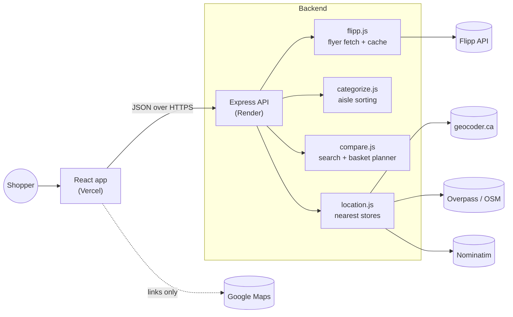
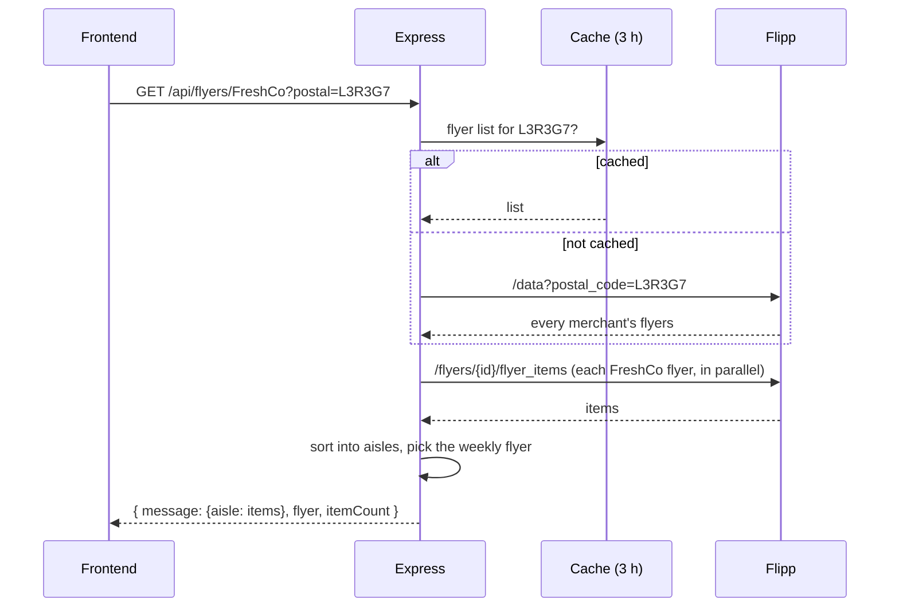
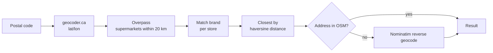
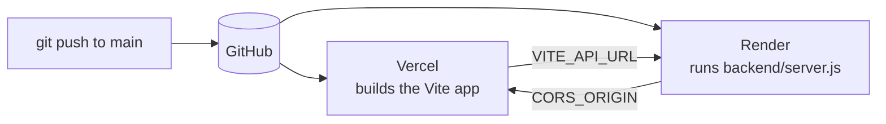

# Flyer Fairy: Architecture

Flyer Fairy shows this week's grocery flyers from stores near a Canadian postal code. It sorts every item into aisles, searches all stores at once and works out the cheapest way to buy a grocery list.

Stores covered: No Frills, T&T Supermarket, FreshCo, Loblaws and Costco.

---

## Tech stack

| Layer | Technology | Why |
| --- | --- | --- |
| Frontend framework | React 19 | Component UI, hooks for state |
| Build tool / dev server | Vite 8 | Fast hot reload, small production build |
| Routing | React Router 7 | `/` home and `/flyers` app pages, views kept in the URL (`?view=search`) |
| HTTP client | Axios | Calls the backend API |
| Styling | Plain CSS with custom properties | One theme file of colour, font and radius tokens |
| Fonts | Google Fonts: Instrument Serif, DM Sans, Pixelify Sans | Titles, body text, pixel accents |
| Linting | ESLint 10 + React Hooks plugin | Includes the React Compiler hook rules |
| Backend | Node.js + Express 5 | Small JSON API |
| Backend HTTP | Axios | Calls Flipp, geocoder.ca, Overpass and Nominatim |
| Tests | Node's built-in test runner (`node --test`) | No extra test framework needed |
| Hosting (frontend) | Vercel | Static site, deploys on every push |
| Hosting (backend) | Render (free web service) | Runs the Express server |

### External data sources (all free, no API keys)

| Service | Used for |
| --- | --- |
| Flipp (`dam.flippenterprise.net`) | Current flyers and flyer items for a postal code |
| geocoder.ca | Postal code to latitude/longitude, and checking a code is real |
| OpenStreetMap Overpass API | Supermarkets within 20 km of a point |
| OpenStreetMap Nominatim | Street address for a store when OSM has no address tags |
| Google Maps (links only) | "Open in Google Maps" search links, no API calls |

---

## System overview



The frontend never talks to Flipp or the map services directly. Everything goes through the backend, which caches results and hides the third-party APIs from the browser.

---

## Repository structure

```
flyer-fairy/
├── index.html              Page shell, Google Fonts link
├── vite.config.js          Vite + React plugin
├── eslint.config.js
├── vercel.json             Sends every path to index.html (client-side routing)
├── render.yaml             Render blueprint for the backend
├── .env                    VITE_API_URL for local dev (gitignored)
│
├── src/                    Frontend
│   ├── main.jsx            React entry point
│   ├── App.jsx             Routes + background sparkles + click sparkles
│   ├── pages/
│   │   ├── Home.jsx        Desktop-style landing page with shortcut icons
│   │   ├── Flyers.jsx      Main app: postal code, menu bar, the three views
│   │   └── Test.jsx        Backend connectivity test page
│   ├── components/
│   │   ├── Retro.jsx       Window, PixelIcon, PixelLoader, MenuBar,
│   │   │                   Sparkles, ClickSparkles
│   │   ├── SearchAll.jsx   "Search by item" view
│   │   └── GroceryList.jsx "Grocery list" view (cheapest basket)
│   ├── lib/
│   │   └── format.js       API base URL, price/title/plural helpers
│   └── styles/
│       ├── global.css      Theme tokens, buttons, windows, menu bar,
│       │                   loader, sparkles, reduced-motion rules
│       ├── Flyers.css      App page layout, cards, grocery list, table
│       └── Home.css        Landing page
│
└── backend/                Backend (its own package.json)
    ├── server.js           Express app, routes, postal code validation
    ├── flipp.js            Flipp fetching, 3-hour cache, weekly flyer pick
    ├── categorize.js       Keyword matcher that sorts items into aisles
    ├── compare.js          Cross-store search and basket planner
    ├── location.js         Postal code geocoding, nearest store lookup
    ├── data/data.js        Aisle keyword lists
    └── test/
        └── compare.test.js Unit tests for matching and the planner
```

---

## Frontend

### Pages and views

| URL | What it shows |
| --- | --- |
| `/` | Welcome window plus desktop icons that jump to each view |
| `/flyers` | **Browse a store**: pick a store, see its weekly flyer sorted into aisle folders |
| `/flyers?view=search` | **Search by item**: one search across all five stores, cheapest first |
| `/flyers?view=list` | **Grocery list**: build a list, get the cheapest way to buy it |

The current view lives in the URL, so it survives a refresh and the browser's back button works.

### State

There's no global state library; each view keeps its own React state.

- **Postal code:** saved in `localStorage`, normalised (`l3r 3g7` → `L3R3G7`) and format-checked on every keystroke. After a 350 ms pause the backend confirms the code is real.
- **Nearby stores:** as soon as a postal code checks out, the app starts looking up the nearest branch of every store in the background. Each postal code gets one shared request, so clicking a store reuses it instead of starting a new lookup.
- **Stale responses:** a request counter makes sure a slow response for one store can't overwrite a store the user clicked afterwards.
- **Grocery list:** saved in `localStorage`. Matches the user removes with "Remove" are kept in state for the current plan only.
- **Search:** runs only when the user presses Enter or the arrow button. Results are tied to the postal code and query they were run for.

### Design system

The theme is "strawberry matcha on a retro desktop".

- **Colours:** CSS custom properties in `global.css`. A matcha scale (`--matcha-50` to `--matcha-700`), a berry scale (`--berry-50` to `--berry-600`), ink colours and an outline colour.
- **Windows:** every section is a `<Window>` with a file-name title bar (`find_stores.exe`, `grocery_list.txt`), pinstripes and decorative window buttons.
- **Pixel art:** icons (strawberry, folder, open folder, magnifier, basket, arrows, sparkle) are stored as small character grids in `Retro.jsx` and drawn as crisp SVG rectangles.
- **Typography:** Instrument Serif italic for titles, DM Sans for anything with numbers or that needs to be read, and Pixelify Sans only for short labels.
- **Motion:** windows pop open, cards pop in one after another, folders unfold, and buttons press in. There's also a pixel loading bar and a small sparkle burst when you click a button. All of it turns off under `prefers-reduced-motion`.

---

## Backend API

Base URL: `http://localhost:8000` locally, the Render URL in production.

| Method | Route | Purpose |
| --- | --- | --- |
| GET | `/`, `/api/health` | Health check: `{ ok: true }` |
| GET | `/api/postal/:code` | Checks a postal code is real and returns the city and province |
| GET | `/api/flyers/:store?postal=` | One store's flyer items sorted into aisles, plus the flyer's dates and logo |
| GET | `/api/search?q=&postal=` | Searches every store's flyer; returns matches per store and overall cheapest first |
| POST | `/api/basket` | Body `{ postal, items: [...], exclude: [ids] }`. Returns the cheapest single store, best two-store split and every-store option |
| GET | `/api/locations?postal=` | Nearest branch of every store, with address, distance and Maps link |
| GET | `/api/location/:store?postal=` | Nearest branch of one store |

Postal codes are validated on the server with a Canadian format regex (no D, F, I, O, Q or U). Invalid codes get a `400`, and codes that don't exist get a `404`.

---

## How the main features work

### 1. Getting flyers (`flipp.js`)



- One Flipp call returns every store's flyers for a postal code, so it's cached and shared across all five stores.
- Some stores run several flyers at once. Costco and FreshCo, for example, have a weekly grocery flyer plus month-long holiday ones. `pickWeeklyFlyer` shows the dates of the one that's valid right now, tagged Groceries and with the shortest run. Items from all of them are still included.
- The cache shares in-flight requests, so two users asking at once trigger a single fetch. Failed requests aren't cached.

### 2. Sorting into aisles (`categorize.js` + `data/data.js`)

- Each aisle has a list of keywords. Every keyword becomes a whole-word regex that also allows a plural ending, so `ham` matches "HAMS" but not "SHAMPOO".
- **The longest keyword wins:** "potato chips" goes to Snacks rather than "potato" to Produce, and "fruit of the loom" goes to Home & Seasonal rather than "fruit" to Produce.
- Items priced $0 or over $50 are skipped.
- Unmatched items from non-grocery flyers go to Home & Seasonal. Anything else unmatched goes to Other.

### 3. Search by item (`compare.js`)

- Every word in the search has to appear in the item name. Singular and plural forms both match: `berry` finds "BERRIES" and `eggs` finds "EGG".
- **Aisle preference:** if the search itself belongs to an aisle ("milk" is Dairy), only matches in that aisle are kept. The check runs across all stores at once, so "milk" never returns milk chocolate or Milk-Bone treats when any store has real milk on sale.
- Results are sorted cheapest first across every store.

### 4. Cheapest basket (`compare.js` → `planBasket`)

For a list of N items across S stores:

1. For each item, find every store's cheapest match.
2. Price every **single store** and every **pair of stores**. For each trip, use the cheapest match among the stores in it.
3. Rank trips by: more items found first, then lower total, then fewer stores.
4. Only suggest two stores if that finds more items or saves at least $1.
5. Also price buying each item wherever it's cheapest, across every store.

With five stores that's 5 single-store trips and 10 pairs, so trying every combination is instant. If the user clicks **Remove** on a match, its id goes into `exclude` and the plan is recalculated with the next cheapest match.

### 5. Nearest store (`location.js`)



- Overpass is often slow or overloaded, so the lookup:
  - tries three mirror servers, with two passes each;
  - caches results per postal code for 7 days;
  - runs one store at a time, so Nominatim stays within its limit of 1 request per second.
- If no branch is found, it still returns a Google Maps search link ("FreshCo near L3R 3G7").

---

## Caching summary

| What | Where | How long |
| --- | --- | --- |
| Flyer list per postal code | Backend memory | 3 hours |
| Items per flyer | Backend memory | 3 hours |
| Postal code → coordinates | Backend memory | Until restart |
| Nearby supermarkets per postal code | Backend memory | 7 days |
| Reverse-geocoded addresses | Backend memory | Until restart |
| Nearest-store request per postal code | Frontend memory | Until page reload |
| Postal code, grocery list | Browser `localStorage` | Until cleared |

All backend caches are in memory, so they reset when the server restarts. That includes every time Render's free plan puts it to sleep.

---

## Testing and quality

- `cd backend && npm test` runs 12 unit tests. They cover:
  - plural matching and whole-word matching;
  - requiring every word of the search;
  - aisle preference across stores;
  - search sorting;
  - basket ranking, two-store savings and excluded matches.
- `npm run lint` runs ESLint with the React Hooks rules. It catches setting state directly inside effects and reading refs during render.
- `npm run build` creates the production build.

---

## Running locally

```bash
# Backend (port 8000)
cd backend
npm install
npm start
```

```bash
# Frontend (port 5173), in another terminal
npm install
npm run dev
```

`.env` in the project root sets `VITE_API_URL=http://localhost:8000`. If it's missing, the frontend uses that address anyway.

---

## Deployment



| Setting | Where | Value |
| --- | --- | --- |
| `VITE_API_URL` | Vercel environment variables | The Render backend URL |
| `CORS_ORIGIN` | Render environment variables | The Vercel site URL (only that site may call the API) |
| `PORT` | Set by Render automatically | The server reads `process.env.PORT`, defaulting to 8000 |

- `render.yaml` sets up the backend as a free web service from the `backend/` folder, with `/api/health` as the health check.
- `vercel.json` sends every path to `index.html`, so refreshing `/flyers` doesn't 404.
- Local development is unaffected. The local `.env` is gitignored, and the hosted sites use their own environment variables.
- Render's free plan sleeps after about 15 minutes idle, so the first request afterwards takes 30 to 60 seconds.

---

## Known limitations and next steps

- **Price comparison is by listed price.** "$8.98/lb" and "$12.99 per pack" are compared as plain numbers. Parsing unit prices (per 100 g, per kg, each) would make "cheapest" more accurate.
- **Matching picks the cheapest match.** "Chicken" can match chicken wieners. The Remove button and more specific searches ("chicken thighs") help.
- **Other aisle:** about 40 items per store still land in Other. A review queue that logs unmatched words and suggests keywords to approve would steadily shrink it.
- **No price history:** Flipp only serves current flyers, so tracking prices over time would need a database (e.g. Postgres) collecting weekly snapshots.
- **Nearest store depends on OpenStreetMap data.** Local brand variations, like Zehrs instead of Loblaws in Waterloo, can mean a chain isn't found.
